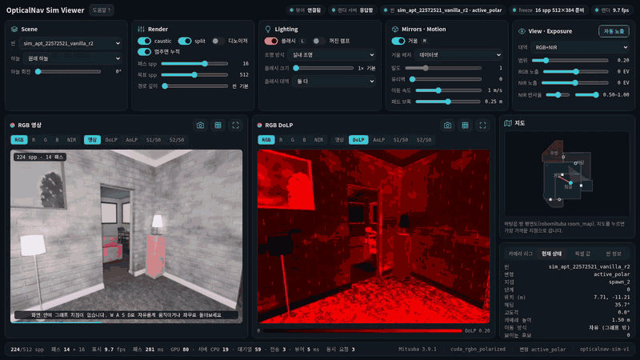
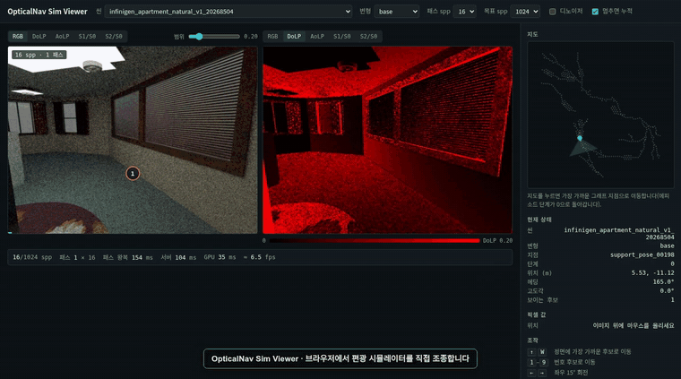
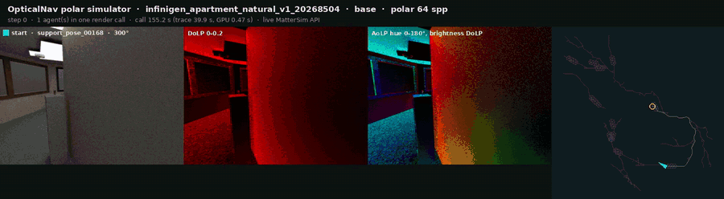
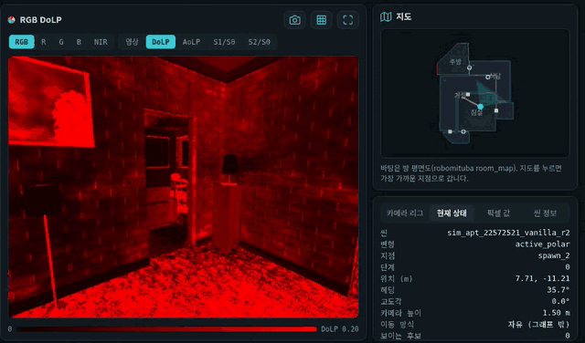
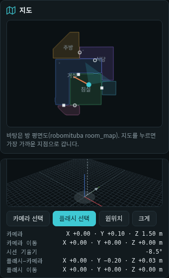
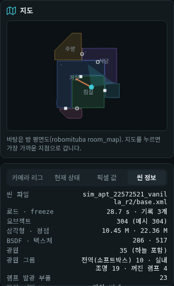
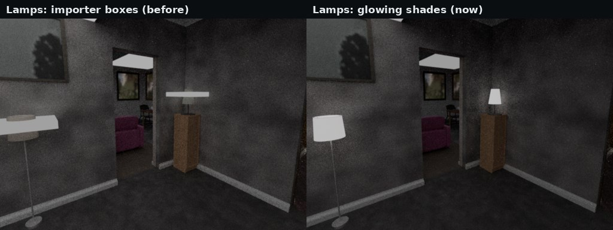
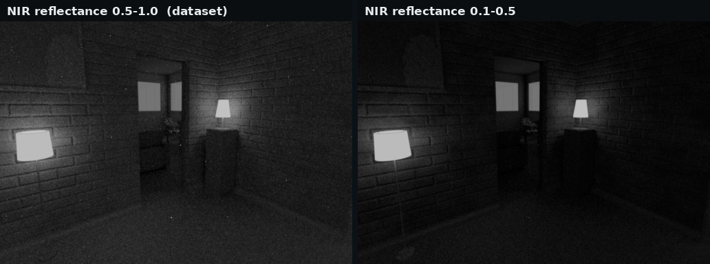
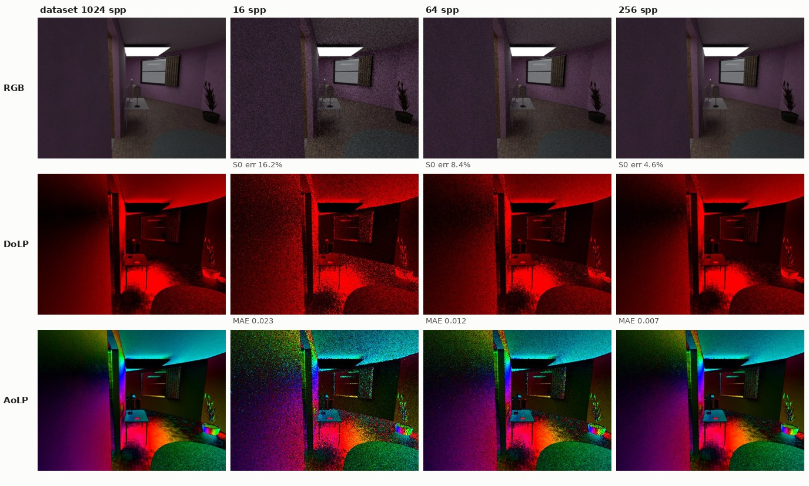
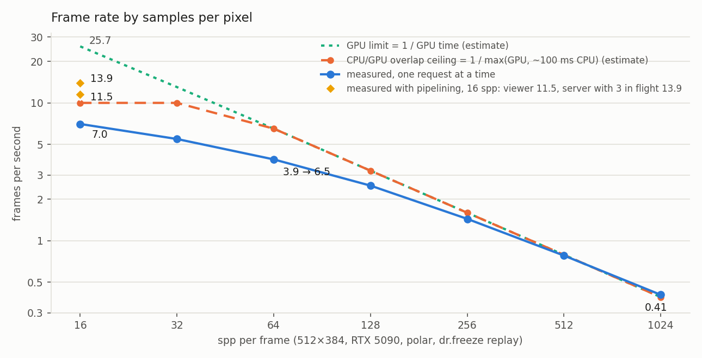

# OpticalNav Polar Simulator

A Matterport3DSimulator-compatible Python API for OpticalNav indoor scenes. Every observation is a physically based **polarization (Stokes) render** made on demand by Mitsuba 3. You can evaluate R2R-style agents in real time, on the graph or at free camera poses. The physics is the same as the OpticalNav dataset the agent was trained on.

```
  your agent ──► opticalnav_sim.MatterSim.Simulator ──HTTP──► render server (GPU, Mitsuba 3)
                 (same API as MatterSim)                       resident scene, Stokes integrator
                 graph logic runs locally                      scene packs: XML + meshes + textures
```

* **Interface.** `newEpisode`, `getState`, `makeAction`, `navigableLocations`, discretised viewing angles and init-only setters all behave as in [Matterport3DSimulator](https://github.com/peteanderson80/Matterport3DSimulator). R2R agent code runs after one import change.
* **Observations.** `state.rgb` is the polar camera's RGB preview (BGR, like MatterSim). `state.stokes` holds the linear Stokes images `s0`, `s1`, `s2`, `s3`, each HxWx3 RGB in the dataset's gravity-aligned basis.
* **Optical variants.** There are three: `base`, `perturbed` (mirrors and glass), and `active_polar` (perturbed plus a camera-aligned linearly polarized flash).
* **Data.** Connectivity is in Matterport3D format and annotations are in R2R format. The evaluation reports NE, OSR, SR and SPL, the same metrics as R2R `eval.py`.

## Demo

[](docs/media/viewer_2026.mp4)

The browser viewer (October 2026 layout) on an RTX 5090, in a base-only scene (`sim_apt_22572521_vanilla_r2`) with its synthetic mirror and flash variants, RGB and NIR in one render. It walks a few steps and turns, then lets the passes accumulate. Next the second pane switches to NIR DoLP, NIR AoLP and RGB S1/S0. Finally the camera light (L) and the mirrors (M) go off and on again. Click the preview for the 28 s recording. *Viewer tools and render options* describes the controls.

[](docs/media/viewer.mp4)

The earlier viewer layout on an RTX 5090. Each move renders one 16 spp pass. While the camera stays put, passes accumulate up to 1024 spp. The second pane switches between DoLP, AoLP, S1/S0 and S2/S0, and the side panel shows the graph map and per-pixel Stokes values. Click the preview for the 40 s recording. It was made before W/A/S/D free movement was added.

[](docs/media/episode_polar.mp4)

An R2R episode driven through the MatterSim API, every frame rendered live at 64 spp. The panels are the RGB preview, DoLP (black to red over 0–0.2), AoLP (hue around the colour circle for 0–180°, brightness DoLP / 0.2), and the planned and travelled path. [Two agents rendered in one call](docs/media/two_agents.mp4) (7 s).

## Quick start

**Scene pack download:** `opticalnav-v0.2`, 13 verified scenes, 13.5 GB (70.6 GB unpacked), in [this Google Drive folder](https://drive.google.com/drive/folders/15R3yz1y2VCdmBkJn_TE0O6gz6H6OzQtI). Fetch all or some of it with `tools/fetch_pack.py` (see *Sharing packs*):

```bash
pip install gdown                       # and: apt install zstd
python tools/fetch_pack.py --from https://drive.google.com/drive/folders/15R3yz1y2VCdmBkJn_TE0O6gz6H6OzQtI --out packs/opticalnav-v0.2 --list
python tools/fetch_pack.py --from https://drive.google.com/drive/folders/15R3yz1y2VCdmBkJn_TE0O6gz6H6OzQtI --out packs/opticalnav-v0.2 --scene infinigen_apartment_natural_v1_20268504
```

**Simulator scenes:** `opticalnav-sim-v1`, 15 staged scenes, 6.0 GB (8.6 GB unpacked), in [this Google Drive folder](https://drive.google.com/drive/folders/1YnQO7sus4iPxiQVbwVwQMx7D0jyaLgRn).

* `sim_apt_12644647` and `sim_apt_22572521_vanilla_r2`: apartments.
* `sim_v2a_cafeP_industrial_47309601`: a single-room industrial cafe.
* Ten Infinigen 2.0 floors: cafes G (small) and H (large), market M (1,772 objects), offices A2, B and C, GP clinic D3, dental clinic E3, physio clinic F3, warehouse J.
* Two single-room scenes: `sim_v2a_bookstoreR_underground_47311301` (a large underground bookstore, 10.7 M triangles) and `sim_v2a_museumR_rotunda_47311401` (a science-museum rotunda). G is the r54 version; M is a snapshot of r6.
* All are base variant only, with spawn points but no navigation graph. The spawn points of the floors and single-room scenes were checked against renders (`tools/check_spawns.py`).
* Walls, floors and ceilings are 2048 px; other textures are capped at 512 px, not the dataset's 128. The market's textures on small objects are cut further (`tools/shrink_textures.py`) and its meshes decimated, so it fits a 32 GB GPU.
* Serve the packs together with a repeated `--pack`. The viewer's scene list shows what the server loaded. Fetch one scene with `--scene`.

```bash
python tools/fetch_pack.py --from https://drive.google.com/drive/folders/1YnQO7sus4iPxiQVbwVwQMx7D0jyaLgRn --out packs/opticalnav-sim-v1
```

Packs fetched before `tools/compact_assets.py` existed still load, but slowly. `fetch_pack.py` compacts the scenes it downloads, and the render server compacts any unconverted scene when it starts (`compact_assets.py --if-needed`).

**0. Build Mitsuba 3 on the GPU host** (once). The server needs the RGB polarized CUDA variants and `dr.freeze` (Mitsuba ≥ 3.6, Dr.Jit ≥ 1.0). *Environment setup* has the details, the plugins `active_polar` needs, and a check script.

```bash
git clone --recursive https://github.com/mitsuba-renderer/mitsuba3   # active_polar: use the robomituba fork instead
cd mitsuba3 && mkdir build && cd build
cmake -GNinja .. -DPython_EXECUTABLE=$(which python3.10) \
    -DMI_DEFAULT_VARIANTS=scalar_rgb,cuda_rgb,cuda_rgb_polarized,cuda_ad_rgb_polarized
ninja                                   # tens of minutes
source setpath.sh                       # WSL2: also export LD_LIBRARY_PATH=/usr/lib/wsl/lib:$LD_LIBRARY_PATH
python3.10 -c "import mitsuba as mi, drjit as dr; mi.set_variant('cuda_rgb_polarized'); print(mi.__version__, 'freeze', hasattr(dr, 'freeze'))"
```

`MI_DEFAULT_VARIANTS` applies only when `build/mitsuba.conf` does not exist yet. In an existing build directory, edit the `"enabled"` list in `mitsuba.conf` and run `cmake` again. The build imports only in the Python it was configured with (`Python_EXECUTABLE`), so run the server with that Python.

**1. Start a render server** on a GPU host that has the scene packs (`tools/fetch_pack.py`, see *Sharing packs*) and a Mitsuba build (see *Environment setup*).

```bash
PYTHONPATH=<mitsuba-build>/python python3.10 -m opticalnav_sim.server \
    --pack packs/opticalnav-v0.2 --port 18770 --preload infinigen_apartment_natural_v1_20268504
```

Repeat `--pack` to serve several packs at once (for example `--pack packs/opticalnav-v0.2 --pack packs/opticalnav-sim-v1`). Scenes not yet compacted are compacted once at start (`--no-compact` skips that; see *Viewer tools and render options*).

**2. Install the client.** It needs only Python 3.8+ and numpy. Point it at the server.

```bash
pip install -e .            # in this directory
export OPTICALNAV_SIM_URL=http://<server-host>:18770
```

**3. Use it like MatterSim.**

```python
import math
from opticalnav_sim import MatterSim

sim = MatterSim.Simulator()
sim.setDatasetPath("http://<server-host>:18770")       # render server (MatterSim: image dataset)
sim.setNavGraphPath("packs/opticalnav-v0.2/connectivity")  # optional: fetched from the server otherwise
sim.setDiscretizedViewingAngles(True)
sim.setBatchSize(1)
sim.initialize()

sim.newEpisode(["infinigen_apartment_natural_v1_20268504"], ["support_pose_00085"], [math.radians(90)], [0.0])
state = sim.getState()[0]
state.rgb                     # uint8 HxWx3, BGR
state.stokes["s1"]            # float16 HxWx3 linear Stokes S1 (RGB)
state.navigableLocations      # [current, candidates sorted by angle from image centre]
sim.makeAction([1], [0], [0]) # move to candidate 1; [0], [1], [0] turns right 30 degrees
```

**4. Run an R2R-style evaluation.**

```bash
python examples/run_agent.py --pack packs/opticalnav-v0.2 --split val_unseen --agent shortest --limit 25
python -m opticalnav_sim.eval --pack packs/opticalnav-v0.2 --split val_unseen --results results.json
```

Replace `choose_action` in `examples/run_agent.py` with your policy. Use `--no-render` to test graph logic without a server.

**5. Drive it by hand in a browser.** The viewer needs numpy and Pillow (`pip install -e .[gui]`).

```bash
python -m opticalnav_sim.gui --pack packs/opticalnav-v0.2 --server http://127.0.0.1:18770 --pass-spp 16 --target-spp 1024
# open http://127.0.0.1:18780 (from another machine or a phone: ssh -L 18780:127.0.0.1:18780 <host>)
```


The page fits the window.

* **Control cards** (Scene, Render, Lighting, Mirrors · Motion, View · Exposure). Switches toggle settings, and step sliders set the numeric ones (pass and target spp, path depth, RR start depth, render size, flash size, glass walls, speed).
* **Two camera panes.** Each has band tabs (RGB, R, G, B, NIR), view tabs (영상, DoLP, AoLP, S1/S0, S2/S0) and a 깊이 (depth) button that is the same in every band, plus buttons to save the JPEG, overlay a thirds grid or go full screen. A phone shows one pane.
* **Map.** The graph, drawn over the scene's room plan when the pack has one.
* **Info tabs.** Camera rig, current state, pixel Stokes values, and scene info.
* **Status bar.** Pass timing split into GPU, server CPU, queue, transfer, viewer, JPEG and screen, plus the Mitsuba version, the variant and the scene's pack.
* **Help.** `?` (or 도움말) opens all keys in a modal.
* **Exposure.** Each band has an exposure slider (RGB 노출, NIR 노출, ±4 EV). 자동 노출 fits both bands' tone to the frame on screen; the near-infrared band has no dataset frames, so otherwise its tone comes from its first frame. Exposure is applied when a pane is sent, so it renders nothing.

* **Moving.** W/A/S/D move freely (forward, left, back, right by the step size), Q/E lower and raise the camera, and dragging with the right mouse button turns the head (a plain right-click turns to the clicked point). ←/→ turn 15°, R/F look up and down, ↑ or 1–9 move to a graph candidate, ↓ turns around, and G snaps back to the nearest graph viewpoint. Space pauses accumulation. M (or the 거울 switch) puts the mirrors and glass in or takes them out (`perturbed` or `base`). L (or the 플래시 switch) switches the camera's active polarized light on or off (`active_polar` or `perturbed`). Both switches stay on the loaded scene. On touch screens a 3×3 button pad replaces the keys, a horizontal swipe turns, and a double tap turns to that point. Clicking the map jumps to the nearest viewpoint. Free movement has no collision check.
* **Rendering** runs on its own, like a game loop. Inputs only change the simulator state and are acknowledged at once. A background loop keeps `--depth` (default 2) passes of the newest camera in flight on the render server. Each pass is `--pass-spp` samples with its own seed; while the camera stays put, passes add up to a running mean until `--target-spp`, and the next input starts over. The seed is an input of the server's freeze recording, so one pass spp costs one recording however many passes run. The first frame for a pass spp records once per pass, about 90–100 s each on Device 1 (see `Resident._prepare_inputs`).
* **One WebSocket** (`/ws`) carries everything: the server pushes the state on every change and the panes' JPEGs for every new frame, and the page sends inputs and probes. The pass threads make each new frame's JPEGs (every open page's channels) and depth grid as it arrives, so the socket only writes them out. Moves are sent at most every 16 ms; each is a new camera and so at most one frame (at 40 ms they capped 256x192 at 25 fps). The HTTP routes (`/api/state`, `/api/action`, …) remain for scripts.
* **Motion warp** (이동 보간 switch, on by default). Until the next frame of a moving camera arrives, each pane shows the last frame drawn from the newest camera: a WebGL mesh at the frame's depth grid (64 cells across, sent with the panes). Turns and moves line up, and near things shift more than far ones. Triangles across a depth edge are left out, so what the frame never saw stays black for that moment instead of stretching. Frames are never blended, so nothing blurs, and a still camera shows the frame as rendered. Against the frame later rendered at the new camera, a 6° turn went from 9.9 to 3.1 mean grey levels apart and a 0.3 m step forward from 11.4 to 3.3.
* **Speed** on an RTX 5090, 16 spp passes, turning, `active_polar` with the flash at the scene's path depth: 27.9 fps at 256x192, 18.5 at 384x288, 12.1 at 512x384. At 512x384 the GPU is the limit (60–68 ms a frame with the flash); below that, the CPU half of a frame. S0 error against the dataset frame fell from 16.2% (1 pass) to 6.2% (8 passes) and 2.9% (64 passes), the same as one render of the same spp.

Render server options that matter here: `GET /v1/status` answers at once with what the server is doing (loading a scene, recording a freeze, rendering), the loaded scenes and their recorded settings. Views are pipelined: the server queues the next view's kernels before reading back the last one, and reads each back without waiting for the ones queued after it (`readback.py`, see *Where a frame's time goes*). `--kernel-history` adds per-kernel GPU times to `X-Render-Timing`, but reading them synchronises the GPU every view, so leave it off except for measurements (`tools/benchmark_modes.py`, `tools/frame_overhead.py`). `OPTICALNAV_SIM_FREEZE_INPUT=sensor` passes only the camera to the frozen render instead of the whole scene; it measured no faster.

**6. Replay exported OpticalNav episodes.** `tools/replay_episode.py` re-renders the episodes of an export (or a robomituba project, or this pack) step by step and writes them in the export bundle's layout.

```bash
python tools/replay_episode.py --pack packs/opticalnav-v0.2 --server http://127.0.0.1:18770 \
    --episodes <bundle dir | bundle.zip | bundle.zip.part000 | robomituba project | episode.json> \
    --scene infinigen_apartment_natural_v1_20268504 --split val_unseen --limit 2 \
    --variants base,perturbed --spp 64 --exposure scene --out runs/replay [--compare <bundle>]
```

* **Step to view.** Step i shows the dataset camera at `(path_nodes[i], path_headings[i])`, the key that `index.jsonl` joins on (`vp_id`, `heading_id`). Camera and base pose reproduce the dataset manifests exactly (checked on 40 views: camera error under 1e-15, base pose identical). Both `adaptive_navigation_support_v4` and the older `viewpoint_graph` episodes load.
* **Sources** (`opticalnav_sim.sources`). An unzipped bundle, `bundle.zip`, or the wizard's split upload (`bundle.zip.partNNN`, read in place as one file, so a 36 GB upload need not be joined or unzipped), a robomituba project, a pack, or one episode file.
* **Output** (`opticalnav_sim.bundle`). `index.jsonl` with the export's fields plus a `render` block (spp, seed, renderer), `images/<variant>/<frame>__polar_cam__<modality>.jpg`, `polarization_raw/<variant>/<frame>__polar_cam__stokes.npz` (float16 S0–S3, schema `minimal_rgb_stokes_f16_v2`), optional `hdr/…s0.exr`, `episodes/`, `graph/`, `dataset_meta.json`. Variants use the export's names (`perturbed_active_polar`). `--image-format none --hdr npz` writes HDR only.
* **Exposure** (`opticalnav_sim.tonemap`). LDR previews use robomituba's scene-global extended Reinhard. `--exposure scene` (the default) takes one exposure and white point from the scene's dataset reference frames, so a scene always renders at the same brightness. Other choices: `episode` (from the first frame), `fixed:<exposure>[,<white>]`, and `auto` (per frame, the legacy preview). On one 142-step episode the largest step-to-step brightness change was 17.6/255 with scene exposure and 76.6/255 with per-frame exposure.
* **Comparison.** `--compare` scores every frame against the dataset's own Stokes for that view (S0 error, S0 8×8 correlation, DoLP error) into `compare.jsonl`. robomituba prunes raw renders after export, so locally only the pack's reference frames remain; compare against an export bundle.
* **Speed.** On an RTX 5090 at 64 spp, two episodes (279 steps, 163 distinct frames) took 68 s, 0.41 s per frame including encoding.

**7. Generate new episodes.** `tools/generate_episodes.py` writes episodes in the dataset's v4 schema on a scene's navigation support graph; `replay_episode.py` then renders them like any other source.

```bash
python tools/generate_episodes.py --pack packs/opticalnav-v0.2 --scene infinigen_apartment_natural_v1_20268504 \
    --count 50 --split train --seed 0 --min-m 3 --max-m 30 --out runs/gen
python tools/replay_episode.py --pack packs/opticalnav-v0.2 --server http://127.0.0.1:18770 --episodes runs/gen \
    --scene infinigen_apartment_natural_v1_20268504 --variants base,perturbed --spp 64 --out runs/gen
```

* **Graph.** The support graph (`scenes/<scene>/navigation_support_graph.json`, copied into the pack by `build_pack.py`) is a state machine of support pose × 24 headings. Its transitions are `turn_left` / `turn_right` (15°) and `move_forward` (0.25 m along collision-checked lanes). Every generated step is one of those transitions (checked: 0 invalid in 20 episodes), and the episode, timestep and extras fields match the dataset's.
* **Routes.** A start state and a goal state are drawn under `--seed` with lane distance in `[--min-m, --max-m]`, then joined by the fewest-action route. `--goal-heading arrive` stops on arrival instead of turning to a drawn heading. robomituba chooses routes differently (blueprint routes, `global_room_length_balance_v1`; 76 of 80 dataset episodes checked were 1–60% longer than the fewest-action route). Its blueprint fields (`blueprint_id`, `pair_signature`, ...) are absent, and `metadata.episode_selection_policy` is `opticalnav_sim_fewest_actions_v1`.
* **Speed.** 20 episodes (43–260 steps) took 0.4 s; rendering one 216-frame episode at 64 spp took 87 s on an RTX 5090.

## Viewer tools and render options

Most of these are per-view settings: the API takes them in a view, `MatterSim` has a setter for each, and the viewer has a control. Changing one reloads nothing. Settings marked *records once* make a new dr.freeze recording the first time they are used (a few seconds); every other change only writes values into the resident scene.

**Camera rig editor** (카메라 리그 tab, `setCameraOffset`, `setFlashOffset`). A three.js view of the observer (a disc and arrow on the floor), the camera and its frustum, and the flash rectangle. Wireframes mark the dataset positions. The axes follow Blender: X right, Y forward, Z up.

* Click to select the camera or the flash, then drag a gizmo arrow.
* `G` grabs the selection: it follows the mouse, `X`/`Y`/`Z` lock an axis, and typed digits move it that many metres. Click or Enter confirms; right click or Esc cancels.
* `Alt+G` puts the selection back. `1`/`3`/`7` show the rig from the front, the right and the top.

Offsets are `[right, up, forward]` in the observer's level frame, so a pitched camera moves the same way. Raising the camera tilts the view down, as the dataset rig does. The flash moves with the camera and keeps facing its view. The render follows the drag.

[](docs/media/rig_editor.mp4)

 

**Scene info tab.** Shows what the resident scene holds: shapes and meshes, triangles and vertices, distinct BSDFs and image textures, lights by group, and the lamp parts that glow. It also shows the emitter sampling weights, the mirror pool, the freeze recordings and the GPU memory, which under WSL is the whole device. It refreshes every 5 s from `GET /v1/scans/<scan>/stats`.

**Room plans.** When a scene has a `room_map.json` (robomituba `tools/infinigen/export_room_map.py`, schema `robomituba.room_map.v1`), the map draws its rooms under the graph: one colour per room type, the room's name, ■ for a door and ○ for an open passage. The viewer reads the file from the pack, else from the project the pack was built from.

**Lamps glow from the lamp.** robomituba's importer turns each Infinigen lamp light into a flat 0.6 × 0.08 × 0.6 m box at a desk or floor lamp's top, or into a 0.6 m square under a ceiling light. The server now moves each light's power (radiance × emitting area) onto the lamp's own glowing part when it loads the scene:

* desk and floor lamps: the shade;
* ceiling lights: every non-metal part, or only the part named as the diffuser (`led`, `panel`, ...);
* pendants and spots with a metal housing: a disk across the opening, facing down.

A light is paired with its lamp by name (the lamp's factory seed and spawn id, or the nearest light of a hand-built kit named by role), then by position, whatever the lamp is called. In the second pass, a light still alone takes the nearest asset whose footprint holds it (10 cm to spare) and that sits within 0.6 m of it vertically: a kit's track spot or ceiling fixture. A light with no fixture at all becomes a round downlight (r 0.1 m) at the square's power. Scene files without `opticalnav-obj` notes pair by shape ids. So no light stays a square: the G cafe went from 26 squares to none, the P cafe from 3, and an old v0.2 apartment from 11.

`tools/light_audit.py --pack <pack>` prints, for each scene, the lights paired by name, by position, and the orphans (lights with no fixture: `--strict` exits 1). `tools/build_pack.py` prints the same line for every scene it builds, so a new kit whose lights no rule matches shows up at import time, not as squares in the viewer.

**Softboxes stay out of view.** The room softboxes (`light_softbox_*`, group `fill`) light the room, but camera rays pass through them: `path_nocaustics`'s `hidden` id prefix (`server.FILL_PREFIX`), as a Blender light with camera visibility off. A softbox is only a light, not an object: a bounce ray goes through its back, and shadow rays ignore it, so the ceiling above it is lit like the rest (kept as an object it left a dark blob there). Its front still emits and shows in reflections. The raster preview leaves their triangles out too. A Mitsuba build whose plugin lacks `hidden` shows them as before. The plugin change is `patches/mitsuba-path_nocaustics-hidden.patch` (against Mitsuba 3.9.1's `src/integrators/path_nocaustics.cpp` with the `split` mode; apply it, rebuild `path_nocaustics`). It costs about 10% of a frame (H: 0.35 to 0.39 s).

The lit parts stay in the scene's lights (group `fixture`, same light class), so lighting modes darken them rather than removing them. `OPTICALNAV_BOX_LIGHTS=1` keeps the boxes. Lamps left dark ("꺼진 램프", `setLamps`) glow the same way, at the power of the scene's own lamp lights.



**Emitter sampling by power.** Next-event estimation picks an area emitter in proportion to its power, not uniformly (Mitsuba's default). Weights average 1, so the environment keeps its share. This is unbiased and cut grain by about 10% in a 33-light apartment. `OPTICALNAV_UNIFORM_EMITTERS=1` turns it off.

**Near-infrared reflectance range** (NIR 반사율, `setNirRange`, view `nir_range`). robomituba's pseudo-NIR albedo `dot(max(c, 1 − c), luma)` lies between 0.5 (mid grey) and 1 (black or white), so every surface reflects at least half the near-infrared. That keeps paths alive and makes NIR noisier than RGB. `rgb2nir` now maps the value linearly onto `[low, high]`, set through two shared uniforms at render time with no recording. 0.5–1.0, the default, is the dataset's formula. At 0.1–0.5 NIR grain fell 43% and outliers 26% (64 spp).



**Split active pass** (split switch, `setActiveSplit`, view `active_split`; *records once*). With the camera light on, the passive and flash passes render on one path. This is `path_nocaustics` `assist_mode=split`: the scene's lights as the passive pass sees them, plus the flash's own emitter sample at each bounce (never caustics). The image is the same as two paths: at 1024 spp the means agreed within 0.1% in RGB and NIR on `20263004` and `sim_apt_22572521_vanilla_r2`. GPU time per 16 spp frame fell from 143 to 101 ms and from 127 to 84 ms. It is on by default.

**Render size** (해상도, `setCameraResolution`, viewer `--resolution`, default 512x384; *records once*). 4:3 from 256x192 to 640x480, keeping the vertical field of view; the page scales the image up. GPU time follows the pixel count (16 spp, flash and split: 96 ms at 512x384, 55 at 384x288, 39 at 320x240, 26 at 256x192), but the CPU half of a frame does not (see below).

**Russian roulette start depth** (RR 시작 깊이, `setRussianRouletteDepth`, view `rr_depth`; *records once*). From this path depth on, a path continues with its throughput's probability (at most 0.95) and is reweighted, so means stay and dim paths end early. Mitsuba starts at 5; the viewer starts at 2 (`--rr-depth`, 0 for Mitsuba's). On `sim_apt_22572521_vanilla_r2`, 512x384, 16 spp:

| setting | GPU per frame | noise RGB / NIR | mean RGB / NIR |
|---|---|---|---|
| depth 6, RR 5 | 94.7 ms | 1.00 / 1.00 | 1.000 / 1.000 |
| depth 6, RR 3 | 76.3 ms | 1.01 / 1.04 | 1.000 / 1.000 |
| depth 6, RR 2 | 68.4 ms | 1.03 / 1.09 | 1.000 / 1.000 |
| depth 4, RR 5 | 82.2 ms | 0.82 / 0.65 | 0.967 / 0.908 |

Capping the depth at 4 looks less noisy because it drops light (NIR 9% darker); RR 2 keeps the light.

**Depth** (깊이 button, view `"depth": true`). The render server also returns each pixel's distance along the view axis (m, 0 where nothing is hit): one ray through the pixel centre against the scene as the frame rendered it, about 1 ms of GPU at 512x384. The pane shows it in turbo (red 0.3 m to blue 12 m, log scale), the pixel tab reads it, and the motion warp uses it.

**Diagnostics** (*records once*).

* **경로 깊이** (`setMaxDepth`) caps every path. 1 shows emitters only, 2 adds direct light, and each step above adds one indirect bounce. Use it to find the bounce where noise or outliers start: mirrors need 3 or more.
* **caustic off** (`setCaustics(False)`) makes the lights' passes drop caustics, as the flash pass always does. It removes the outliers of diffuse → mirror, glass or glossy → light paths, and with them that light, including sky light through glass windows.

**Base-only scenes.** A scene packed with only its `base` variant gets `perturbed` (its mirror pool at robomituba density 1, from `tools/build_perturbation_pool.py`) and `active_polar` (the dataset's flash: 0.12 × 0.08 m, 0.2 m behind the camera, polarized, two-pass) on the same resident scene. Their scene meta marks them as `variants_synthetic`. A scene with dataset mirrors but no flash gets only the flash.

**Several packs, compacted at start.** `--pack` can be repeated, for the render server and the viewer. A scene name that appears in two packs is served from the first. Scene meta carries `scene_dir`, so a viewer on the same machine finds every scene's tone frames and room plan. At start the server compacts each scene that still needs it (`tools/compact_assets.py --if-needed`, one child process per scene) before serving it. `compact_assets` locks a scene (`<scene>/.compact.lock`), so a scene another process is compacting is skipped. `--no-compact` serves scenes as they are, and `--compact-skip SCAN` leaves out one.

**What did not speed rendering up** (`infinigen_apartment_natural_v1_20268504`, 16 spp RGB + NIR with the split active pass, measured with nothing else on the GPU):

| change | triangles | distinct BSDFs | GPU per frame | GPU memory (rendering) | image |
|---|---|---|---|---|---|
| dataset scene | 12.17 M | 215 | 97 ms | 7.4 GB | — |
| heavy meshes decimated (`tools/decimate_meshes.py`, 71 units ≥ 50k triangles to 10%) | 3.48 M | 215 | 88–90 ms | 3.9 GB | mean +0.08%, sofa folds smoother |
| materials folded into atlases (`tools/atlas_materials.py`, not in the repo) | 12.17 M | 47 | 100 ms | 11.9–13.3 GB | mean within 0.02% |

* **Triangles.** OptiX ray traversal grows roughly with the logarithm of the triangle count, so cutting triangles by 72% saved 9% of the frame. It still halves the GPU memory.
* **Materials.** Folding them saved per-render tracing and code generation (Mitsuba 3.7), which dr.freeze replay no longer pays. It cost 4–5 GB for the float atlas pages and doubled the load time. It does cut the CPU half of a frame, though (see below): the frozen replay fell from 7.8 to 1.9 ms.
* **Textures.** Mitsuba keeps bitmaps as float32 RGB on the GPU, so a 4096² map costs about 200 MB. On `sim_apt_22572521_vanilla_r2` (41 structure maps, 623 others) GPU memory while rendering was 14.2 GB with 4096 structure maps and 128 px for the rest. With 2048 and 512 it was 9.3 GB, with no change in frame time (78–79 ms).

**Where a frame's time goes.** A frame is GPU work plus a CPU half on the server's render thread (camera write, the frozen replay, readback), about 10–17 ms whatever the size.

* **Readback overlap.** The server queues frame N+1 before reading N back, but Dr.Jit's readbacks (`dr.sync_thread`, `np.array`) wait for the whole CUDA stream, so reading N also waited for N+1. The next frame's CPU half then ran with the GPU idle: GPU busy 81% at 512x384 and 58% at 256x192. `opticalnav_sim/readback.py` puts each image's and depth's copy to page-locked host memory on the stream right behind its own kernels, with a CUDA event, and waits for that event alone. It calls Dr.Jit core's exported `jit_cuda_stream`, `jit_var_data` and `jit_memcpy_async` and the CUDA driver through ctypes. `OPTICALNAV_ASYNC_READBACK=0`, or a build without them, reads back as before. The server alone, 3 views in flight, base, 16 spp: 512x384 went from 19.1 to 22.9 fps (GPU busy 96%), 256x192 from 52.3 to 73.2 (84%). Alternating two opposite cameras 120 times, every result was its own camera's (depth exactly equal).
* **The frozen replay is the scene walk.** About 8–10 ms a frame, and a frozen no-op over the same inputs (scene, sensor) costs the same: Dr.Jit walks every input variable each call. The walk follows the registry, which holds every live BSDF and texture, nested ones included (two-sided wrappers, `rgb2nir` and its colour). On `sim_apt_22572521_vanilla_r2` that is 304 shapes, 690 BSDFs and 1170 textures for the 286 BSDFs and 517 textures the scene lists. On `20268504` the material atlas took it from 225 / 525 / 901 to 61 / 77 / 136 and the replay from 7.8 to 1.9 ms.

## Environment setup

The client side (agents, `MatterSim`, evaluation, the browser viewer) needs only Python and numpy (plus Pillow for the viewer). The render server needs an NVIDIA GPU, a Mitsuba 3 build with the right variants, and the scene packs. This section walks through the render host. The paths in the examples are Device 1's (RTX 5090, WSL2).

### 1. Host

| Item | Requirement | Device 1 |
|---|---|---|
| GPU | NVIDIA with OptiX; one resident scene takes about 10 GB, large residences more | RTX 5090, 32 GB, driver 580.97 |
| CUDA toolkit | only to build Mitsuba | 12.8 |
| OS | Linux, or WSL2 | WSL2 (Ubuntu) |
| Python | the version Mitsuba was built for | 3.10.12 (`/usr/bin/python3.10`) |

On WSL2 the CUDA driver library lives in `/usr/lib/wsl/lib`, so put it on the library path in every shell that imports Mitsuba:

```bash
export LD_LIBRARY_PATH=/usr/lib/wsl/lib:$LD_LIBRARY_PATH
```

### 2. Mitsuba 3

**Variants.** `polar` mode uses `cuda_rgbn_polarized` when the build has it (see below), else `cuda_rgb_polarized` (the server falls back to `cuda_ad_rgb_polarized`, which renders the same images but needs more GPU memory). `--variant cuda_rgb_polarized` keeps the two-slot render on a build that has both. `rgb` mode needs `cuda_rgb` or `cuda_ad_rgb`. A PyPI `mitsuba` wheel ships a fixed set of variants; check `mi.variants()`, and build from source when the RGB polarized variants are missing.

**Real-time rendering** needs `dr.freeze` (Dr.Jit ≥ 1.0 with Mitsuba ≥ 3.6; this code also passes `auto_opaque`, present in Dr.Jit 1.2). Without it every frame re-traces the scene, about 50 s per polar frame.

**Plugins for `active_polar`.** Scenes render through the robomituba fork of Mitsuba (`robomituba/modules/mitsuba3`): v3.7.1 plus the `polarized_area` emitter (commit `0b79cb01`, branch `stable`). Two-pass `active_polar` scenes also need the `path_nocaustics` integrator. In that tree it is still an uncommitted file (`src/integrators/path_nocaustics.cpp`, listed in `src/integrators/CMakeLists.txt`), and the simulator needs its camera-assist options (`caustics`, `assist`, `assist_mode`). This repository keeps a copy with those options in `mitsuba/path_nocaustics.cpp`: copy it to `src/integrators/`, add `add_plugin(path_nocaustics path_nocaustics.cpp)` to that folder's `CMakeLists.txt`, and build. With them, one resident scene renders a variant with the flash and without it (see *Active light on and off*). A build without them reports `path_nocaustics=False` and hides those variants. `base` and `perturbed` need neither plugin. To add the plugin to an existing build, run `ninja path_nocaustics` in the build directory (about 30 s on Device 1, which has it since 2026-10-12).

**Mitsuba 3.9.1 with `cuda_rgbn_polarized` (recommended).** `mitsuba/mitsuba-3.9.1-opticalnav.patch` carries everything above onto upstream v3.9.1 (Dr.Jit 1.5), plus:
* **`cuda_rgbn_polarized`.** Its spectrum is `MuellerMatrix<Color<Float, 4>>`: R, G, B and a near-infrared lane travel one path, each with its own Mueller matrix, so one render holds both bands. Reflectances get their near-infrared lane from `rgb2nir` (pseudo NIR), lights from `bandscale` (per-class levels), the sky from `path_nocaustics` `sky_nir`, and named conductors (`Ag`, `Al`, …) from their spectral eta/k averaged over 800–900 nm; any other colour's lane is its luminance. `stokes` writes `S0.R, S0.G, S0.B, S0.N`, … On a Device 1 apartment it matched the two-slot render within noise (means ≤ 0.2% apart in all six Stokes images).
* **Moving one small shape rebuilds only its acceleration structure.** Before, every write to the flash's `to_world` rebuilt the GAS of every mesh in the scene (~40 ms a frame on Device 1).
* Two 3.9.1 build fixes: the `batch` sensor's traversal also registers `m_last_index`, and a build without `_ad_` variants links `drjit-extra`.

```bash
git clone --recursive --branch v3.9.1 https://github.com/mitsuba-renderer/mitsuba3 mitsuba3-3.9.1
cd mitsuba3-3.9.1 && git apply <opticalnav_sim>/mitsuba/mitsuba-3.9.1-opticalnav.patch
mkdir build && cd build && cmake -GNinja .. -DPython_EXECUTABLE=/usr/bin/python3.10
# in build/mitsuba.conf: "enabled": ["scalar_rgb", "cuda_rgb", "cuda_rgb_polarized", "cuda_rgbn_polarized"]
cmake . && ninja
```

On Device 1 (`/home/jinnyeong/robomituba-build/mitsuba3-3.9.1`), with the 3.9.1 build, RGBN and the server changes of 2026-10-13, an `active_polar` RGB+NIR frame at 4 spp went from 244 ms to about 70 ms with a moving camera, and a scene loaded in 65–85 s instead of 144 s. The `.cpp` files in `mitsuba/` are the patch's versions of those plugins.

**Build** (once per host and Python version):

```bash
cd robomituba/modules/mitsuba3          # or: git clone --recursive https://github.com/mitsuba-renderer/mitsuba3
mkdir -p build && cd build
cmake -GNinja .. -DPython_EXECUTABLE=/usr/bin/python3.10 \
    -DMI_DEFAULT_VARIANTS=scalar_rgb,cuda_rgb,cuda_rgb_polarized,cuda_ad_rgb_polarized
# MI_DEFAULT_VARIANTS seeds build/mitsuba.conf when it is created. In an existing build directory, edit its
#   "enabled": ["scalar_rgb", "cuda_rgb", "cuda_rgb_polarized", "cuda_ad_rgb_polarized"]
# and run cmake -GNinja .. again.
ninja                                    # tens of minutes; each variant adds compile time
```

Device 1's build is at `/home/jinnyeong/robomituba-build/mitsuba3` and also enables `cuda_spectral`, `cuda_ad_spectral` and `cuda_ad_spectral_polarized`.

**Activate and check.** A build only imports in the Python it was configured with. With any other version, `import drjit` fails with "the Python version for which Dr.Jit was compiled (3.10.12) is incompatible with the current interpreter".

```bash
B=/home/jinnyeong/robomituba-build/mitsuba3
export LD_LIBRARY_PATH=/usr/lib/wsl/lib:$B:$LD_LIBRARY_PATH PYTHONPATH=$B/python   # or: source $B/setpath.sh
/usr/bin/python3.10 - <<'PY'
import mitsuba as mi, drjit as dr
print(mi.__version__, dr.__version__, "freeze:", hasattr(dr, "freeze"))
print([v for v in mi.variants() if v.startswith("cuda")])
mi.set_variant("cuda_rgb_polarized")
for spec in ({"type": "polarized_area"}, {"type": "path_nocaustics", "assist": "camera_assist", "assist_mode": "exclude"}):
    try:
        mi.load_dict(spec); print(spec["type"], "ok")
    except Exception as exc:
        print(spec["type"], "missing")
PY
```

On Device 1 this prints `3.7.1 1.2.0 freeze: True`, the CUDA variants, `polarized_area ok` and `path_nocaustics ok`.

### 3. Python packages

| Process | Python | Packages |
|---|---|---|
| render server (`opticalnav_sim.server`), `tools/check_parity.py` with a local renderer | the Mitsuba Python (3.10 on Device 1) | numpy, Pillow |
| `MatterSim` client, agents, `opticalnav_sim.eval`, replay and generation tools | any Python ≥ 3.8 | numpy (`pip install -e .`) |
| browser viewer (`opticalnav_sim.gui`), sample frames | any Python ≥ 3.8 | numpy, Pillow (`pip install -e .[gui]`) |
| `tools/record_episode.py` | any | numpy, Pillow, and the `ffmpeg` binary |

### 4. Scene packs

Build packs from a robomituba OpticalNav project with `tools/build_pack.py` (see *Scene packs*), or copy one from another host. With `--link hard` a pack costs no extra disk on the same filesystem; use `--link copy` for a pack you move elsewhere. Each scene folder holds its scene XMLs and assets (relative paths only), `scene.json`, the navigation support graph, the original episodes and a few dataset reference frames.

### 5. Start and warm up

```bash
cd opticalnav_sim
B=/home/jinnyeong/robomituba-build/mitsuba3
export LD_LIBRARY_PATH=/usr/lib/wsl/lib:$B:$LD_LIBRARY_PATH PYTHONPATH=$B/python:.
CUDA_VISIBLE_DEVICES=0 timeout 6h /usr/bin/python3.10 -u -m opticalnav_sim.server \
    --pack packs/opticalnav-v0.2 --port 18770 --modes polar --max-resident 1 \
    --preload infinigen_apartment_natural_v1_20268504:base:polar
```

* The start line should read `modes={'polar': 'cuda_rgbn_polarized'} … freeze=True` (or `cuda_rgb_polarized` on a build without the RGBN variant).
* **Expect waits.** Loading a scene takes about 100 s (`--preload`, or the first request for it). The first frame of each spp and resolution records the freeze, about 25 s on the 3.9.1 RGBN build (light on and off together), 90–100 s per pass on the 3.7.1 build. Later frames replay in tens of milliseconds. With `--max-resident 1`, every scene switch pays the load and the recordings again. A variant switch within a scene does not reload (see *One resident scene for all three variants*); `base` and `perturbed` share their recordings. `GET /v1/status` (and the viewer's status bar) says which of these is running.
* **GPU memory.** Use `--max-resident 1` when the GPU is shared. Freeze recordings failed twice when the card was nearly full, and a server whose recording failed fails every later render until it restarts.
* **Shared machines.** Start servers under `timeout` so a forgotten one does not hold the GPU. Bind beyond localhost only with a token (`--host 0.0.0.0 --token …`). On WSL2, other machines reach the port only after Windows forwards it (`netsh interface portproxy add v4tov4 listenport=18780 connectaddress=<WSL IP> connectport=18780` and a firewall rule).

### 6. Troubleshooting

| Symptom | Cause and fix |
|---|---|
| `ImportError: … Python version for which Dr.Jit was compiled (3.10.12) is incompatible` | wrong interpreter: run the Python the build was configured with |
| `libcuda.so` not found, or no CUDA device (WSL2) | `export LD_LIBRARY_PATH=/usr/lib/wsl/lib:$LD_LIBRARY_PATH` |
| `no Mitsuba variant for polar mode` | the build lacks `cuda_rgb_polarized` / `cuda_ad_rgb_polarized`: enable it in `mitsuba.conf` and rebuild |
| start line says `freeze=False` | Dr.Jit older than 1.0: every frame re-traces (~50 s polar); upgrade Mitsuba/Dr.Jit |
| `active_polar` missing for new scenes, `path_nocaustics=False` | build the fork's `path_nocaustics.cpp` with the assist options (`ninja path_nocaustics`) |
| `record(): … not permitted` or `error encountered while recording a frozen function` | a freeze recording failed, usually with GPU memory nearly full; restart the server, keep `--max-resident 1`, free the GPU |
| the first frame takes minutes | a scene load or freeze recording; see `GET /v1/status` or the viewer's status bar |

## API

| MatterSim | opticalnav_sim | Notes |
|---|---|---|
| `setDatasetPath(path)` | render-server URL | default `$OPTICALNAV_SIM_URL` or `http://127.0.0.1:18770` |
| `setNavGraphPath(path)` | connectivity directory | optional; otherwise fetched from the server |
| `setCameraResolution(w, h)`, `setCameraVFOV(rad)` | same | default is the dataset polar camera: 512x384, 90° HFOV |
| `setElevationLimits`, `setDiscretizedViewingAngles`, `setRestrictedNavigation`, `setBatchSize`, `setSeed`, `setRenderingEnabled` | same | init-only where MatterSim's are |
| `setPreloadingEnabled`, `setCacheSize` | accepted, no effect | the server owns scene residency (`--max-resident`) |
| `setDepthEnabled(True)` | raises | polarization only |
| `newEpisode`, `newRandomEpisode`, `getState`, `makeAction`, `close`, `resetTimers`, `timingInfo` | same | |

State fields `scanId`, `step`, `rgb`, `depth`, `location`, `heading`, `elevation`, `viewIndex` and `navigableLocations` behave as in MatterSim. `ViewPoint` has `viewpointId`, `ix`, `x`, `y`, `z`, `rel_heading`, `rel_elevation` and `rel_distance`.

Extensions:

| Call | Purpose |
|---|---|
| `setVariant("base" \| "perturbed" \| "active_polar")` | Default optical variant. A scan id `<scene>__<variant>` overrides it per episode. It applies from the next render, mid-episode too. |
| `setActiveLight(enabled)` | The camera-mounted active polarized light on (`active_polar`) or off (`perturbed`), from the next render. The server reuses the loaded scene, so switching reloads nothing. |
| `setRenderMode("polar" \| "rgb")` | `polar` renders the dataset's Stokes sensor. `rgb` loads the same scene without the Stokes wrapper on a non-polarized variant, so it is faster and returns `state.radiance` only. |
| `setDenoiser(True)` | Runs the OptiX AI denoiser on every frame. In polar mode it denoises the images behind linear polarizers at 0°, 45°, 90° and 135°, `(S0±S1)/2` and `(S0±S2)/2`, then recombines S0, S1 and S2; S3 stays as rendered. |
| `setRenderSpp(n)`, `setRenderSeed(s)`, `setStokesDtype("float16" \| "float32")` | Noise and precision. Dataset frames used 1024 spp; the default is 64. |
| `teleport(scanIds, positions, headings, elevations)` | Start at free camera poses. A position is `[x, y, z]` in the connectivity frame, with z the height above the floor. `location.viewpointId` is the nearest viewpoint, and moving to a candidate snaps back onto the graph. |
| `renderCamera(scanId, camera_to_world)` | Render one raw dataset camera, such as `index.jsonl` `camera_to_world`. Returns `{rgb (RGB), s0..s3}`. |
| `state.radiance`, `state.stokes`, `state.camera_to_world`, `state.variant` | Linear RGB radiance (equal to S0 in polar mode), the polarization images (polar mode only), the exact camera that rendered them (dataset convention), and the variant used. |
| `opticalnav_sim.stokes.derived(s0, s1, s2)` | DoLP, AoLP and normalised S1/S0, S2/S0, computed as the dataset defines them. |
| `opticalnav_sim.RenderClient(url).render([...])` | Low-level batch rendering of dataset-convention cameras. |

## Conventions

* **Connectivity / state frame.** The frame is right-handed and z-up, like Matterport3D: `(x, -y_dataset, height)`. `heading` follows MatterSim: 0 looks along +y, and positive turns right. `elevation` is measured from the dataset camera's pitch (about -8.5 degrees), so `elevation = 0` reproduces dataset views exactly. Positive elevation looks up.
* **Joining with the training data.**
  * `viewpointId` is the dataset `vp_id`, a `support_pose_*` node of `navigation_support_graph.json`.
  * Dataset heading `h_XXX` is yaw XXX degrees. The simulator heading for it is `pi - radians(XXX)`, so discretised heading step k is `h_{(180 - 30k) mod 360}`.
  * `state.camera_to_world` uses the same row-major matrix convention as `index.jsonl`.
* **Camera.** At graph viewpoints the optical centre follows the dataset rig exactly. It sits at 1.5 m height, offset 0.1 m from the viewpoint in a heading-dependent direction. `tests/test_sim.py` reproduces stored dataset camera matrices to 1e-9. `teleport` puts the optical centre exactly at the given position.
* **Stokes.** The channels are linear RGB radiance per component, in reference basis `world_gravity_y_v1` (reference axis = world up), the same as the dataset `stokes_data.npz`.
* **Variants.** `active_polar` follows the protocol each scene was rendered with, recorded in `scene.json` as `variants.active_polar.protocol`.
  * `active_polar_flash_nocaustics_v1` (the re-rendered scenes) is `perturbed` plus a flash-only pass, summed as linear Stokes. The flash pass uses a camera-aligned linearly polarized `polarized_area` emitter and the `path_nocaustics` integrator.
  * `rgb_stokes_12_active_polar_compact_flash_v2` (older scenes) is a single pass with the room lights and a camera-aligned area flash together. In that protocol the polarizer sits behind the emitter, so the flash is effectively unpolarized. This matches those scenes' training data.
* **One resident scene for all three variants.** `perturbed.xml` is `base.xml` plus mirror and glass cubes (`mirror_auto_*`, `glass_auto_*`, 7–38 per scene) and their BSDFs, and nothing else differs. `active_polar` adds the camera-assist shapes: the flash rectangle, and in older scenes its polarizer. Older scenes' `active_polar.xml` is `perturbed.xml` plus those shapes, apart from the sensor that the server sets every frame. The server checks these relations when it plans a variant, and loads only the largest scene of a scan. `base` is that scene with the mirror and glass cubes collapsed to a point (degenerate triangles, so nothing hits them and they cast no shadow), restored from a copy for `perturbed`. Switching among the three edits GPU memory and loads nothing, so `--max-resident 1` keeps all three resident. `GET /v1/status` lists every variant that a resident scene serves.
* **Indoor lights and sky.** A view may also carry `"lights"` (a factor on every indoor emitter's radiance; 0 is all off, and the camera flash is not affected) and `"env"` (`{"map": "original" | <name>, "scale", "rotate_deg"}`). At load, the scene's environment emitter (a `constant` sky, or a plain `envmap`) is replaced by an `envmap` at 1024x512 whose pixels reproduce the original. Maps are the `.exr`/`.hdr` files in `<pack>/envmaps` (or `--envmaps DIR`), resampled to that size, and `GET /v1/info` lists them as `envmaps`. A uniform envmap rendered the same as the constant sky (0.28% apart at 1024 spp on a test scene, within noise). In the MatterSim API these are `setIndoorLights(level)` and `setEnvironment(name, scale, rotate_deg)`. In the viewer they are the 실내등 button (I), the 하늘 menu, and its rotation slider.
* **spp, denoising, sun.** The server records at `--freeze-spp` (default 16) only: a request for a multiple of it replays that recording several times with new seeds and averages (64 and 256 spp then took 0.47 and 1.0 s, with no recording). `POST /v1/denoise` (`RenderClient.denoise`) runs the OptiX denoiser on finished images, so the viewer accumulates raw passes and denoises the mean it shows, instead of averaging denoised 16 spp passes, which smeared detail. A sun in an environment map is spread over a Gaussian of `--sun-deg` degrees (default 8), keeping its power. Sunlight reaches a wall through window glass only along delta paths, which a path finds by chance, so a 0.5° sun carrying 62–83% of a map's light (`sunny_day`, `blue_hour`) rendered as fireflies. The peak drops from 133,920 to 114 for `sunny_day`; `overcast_day` is unchanged.
* **Progress.** `GET /v1/status` adds `activity.progress` while a scene loads or a frozen render records (`opticalnav_sim/progress.py`):
  * For a load: the files read so far, from Mitsuba's Debug log, against those the scene file names. A Device 1 apartment read 3528 files in 121 s.
  * For a recording: the call (1/2, 2/2), the stage, and the last log lines, from Dr.Jit's log hooked through ctypes (`jit_set_log_level_callback`). The stage is tracing, then code generation with kernels k/N. A Device 1 apartment took 22 s of tracing, then 68 s of code generation for one 107k-op kernel.
  * An estimate of the time left. A load uses the files times seconds per file. A recording uses an earlier recording of the same settings if there is one, otherwise the scene's size (BSDFs + textures + shapes in the XML) times seconds per element. Past rates are kept in `~/.cache/opticalnav_sim/freeze_timings.json`. On the second recording of a setting, the estimate was 181 s against 189 s taken.
  * The server listens before `--preload` loads, so the viewer shows all of this from the start.
* **Nothing here records again.** Hidden mirrors (collapsed vertices), the flash's place, light radiance (opaque `srgb`/`uniform` values) and the envmap's pixels, scale and rotation are all scene parameters that a frozen replay reads. Each is written once as an opaque value before the first recording: a plain Python float for `scale` would be baked in as a literal and record again on its first change. On a test scene, 8 such changes in a row made 0 new recordings, and every frozen frame matched an unfrozen render of the changed scene exactly. Shapes cannot be hidden by instancing them instead: a frozen render cannot trace the nested call into a shape group.
* **Near-infrared band.** Four plugins in `mitsuba/` turn this on. Copy them into the fork and build them (`ninja rgb2nir bandscale batch path_nocaustics`, 28 s on Device 1):
  * `rgb2nir.cpp` (`src/textures/`) wraps every base colour (`diffuse_reflectance`, `specular_reflectance`: 1281 slots in a Device 1 apartment). It returns the colour, or robomituba's `pseudo_nir_albedo`, `dot(max(c, 1 - c), [0.229, 0.587, 0.114])`, computed per lookup, so no second set of textures is loaded.
  * `bandscale.cpp` (`src/textures/`) scales a light's radiance per band.
  * `batch_slot_time.patch` adds `slot_time` to `src/sensors/batch.cpp`.
  * `path_nocaustics.cpp` (`src/integrators/`) adds `sky_nir`.

  A view's `"bands"` is `"rgb"` (the default), `"nir"` or `"both"`. **Both bands render in one call.** A `batch` sensor holds two copies of the camera, and `slot_time` gives the second slot's rays time 1. `rgb2nir` and `bandscale` read the ray's time, and `path_nocaustics` (`sky_nir`) scales the sky those rays see, so the left half is visible and the right half near-infrared. Each slot has 3 pixels a side to spare, cropped off, so the reconstruction filter does not blend the bands at the seam. On a test scene each half matched a single-band render (0.28% and 0.30%).
  * Light levels per band are shared `uniform` textures: `light_rgb_<group>`, `light_nir_<group>_<class>`, `flash_rgb`, `flash_nir`. Classes come from the scene file's `opticalnav-obj` notes: a `PointLampFactory` lamp without a panel shape is incandescent, ceiling panels and softboxes are LED. The near-infrared levels default to robomituba's `NIR_PASSIVE_SCALE_POLICY` (LED 0, incandescent 0.45, daylight 0.75), and a view's `"nir"` overrides them. Changing a level or the flash band (`"flash_band"`: `"rgb"`, `"nir"` or `"both"`) writes a value and records nothing.
  * The uniforms are declared with distinct odd values and found by them after loading. The loader merges objects with equal properties, and uniforms declared alike (0 or 1) became one object that every switch wrote at once.
  * Near-infrared Stokes images are collapsed to luminance, `nir_s0..nir_s3` (HxW). In the MatterSim API these are `setBands`, `setFlashBand`, `setNirScales` and `state.nir_stokes`. In the viewer they are the 대역 and 조명 대역 menus and the NIR, NIR DoLP and NIR AoLP panes.
  * Measured on Device 1 at 16 spp, 512x384, steady frames: RGB 78 ms, RGB+NIR 149 ms, `active_polar` RGB+NIR with the flash in both bands 257 ms. Rendering the bands one after the other cost 310 ms, most of it two whole-scene parameter updates per frame.
  * **`cuda_rgbn_polarized` replaces the two slots** (see *Environment setup*): every render holds both bands, so `"rgb"`, `"nir"` and `"both"` cost the same and share one recording. The server turns the film's four lanes into the same RGB and near-infrared outputs as before (`stokes.rgbn_band`). `active_polar` at 16 spp, 512x384: 237 ms with two slots, 185 ms with RGBN, on the same 3.9.1 build.
* **Lighting modes.** `"lighting"` is `"none"`, `"fixtures"` or `"all"` (the default, as in the dataset). Fixtures are Infinigen's own lights: emitter cubes or ceiling panels at its lamp and ceiling-light meshes. `all` adds the room softboxes that robomituba's importer synthesizes for even fill (`light:softbox:...`). A light a mode leaves out is dark (its group's uniforms at 0) and lifted 3 m out of the room at full size. Rectangle lights load as two-triangle PLY meshes: the first write of a rectangle's `to_world` after a recording added 64 opaque inputs and recorded again, while vertex moves replay. In the MatterSim API this is `setLighting`; in the viewer, the 조명 menu or I.
* **Random mirrors and glass walls.** `tools/build_perturbation_pool.py` runs robomituba's `navigation_dataset.optical_perturbation` unchanged at density 4. Mirrors go on wall runs from the Infinigen wall meshes (or room rectangles when those meshes are gone), and glass walls across the viewpoint graph's longest edges with a detour left. The result is kept as `scenes/<scene>/perturbation_pool.json`, holding the cube XML (as robomituba's render daemon writes it) and, per glass wall, the R2R edges it blocks.
  * The server loads the whole pool hidden. `"mirrors": {"density": d, "glass": k}` shows d/4 of the mirrors by rank and the first k glass walls instead of the variant's own. Each pool shape has its own BSDF, a millionth apart, so the loader does not merge it into, say, the window glass.
  * The R2R graph is a lane graph, so most glass walls that block a lane cut part of the scene off. Those are flagged (`splits_r2r`) and used only with `"glass_blocking": true`.
  * MatterSim's `setMirrors(density, glass)` drops the blocked edges from `navigableLocations`. In the viewer this is 거울 배치 (데이터셋 / 랜덤 풀), 밀도 and 유리벽.
* **Switches on Device 1** (RGB+NIR, after the first recordings), none of them recording again:

  | Switch | Time |
  |---|---|
  | lighting none, fixtures and all, back and forth | 0.8–1.6 s |
  | pool density, glass walls, dataset mirrors | 1.3–2.1 s |
  | `base`, `active_polar` | 0.26–0.66 s |

  The time goes to rebuilding the acceleration structure.
* **One recording per pass, and nothing records again.** A frozen render's inputs are its arguments plus every live shape, emitter and sensor (Dr.Jit's registry), each variable keyed as literal or evaluated and by size. Three things changed those inputs after a recording, and each made recordings record once more (about 90 s each on Device 1):
  * A transform written from the host stays a literal until a render evaluates it. Frames that moved the flash and frames that did not gave two layouts, 64 opaque variables apart (43627 vs 43691). The server now evaluates every written transform at once (`Resident._evaluate_transforms`).
  * The dual sensor, made on the first RGB+NIR frame, joined the registry and changed every earlier recording ("number of elements in the input changed from 181902 to 181905"). Its first render also filled its slot index and film storage. It is now made, sampled once and prepared before the first recording at that size.
  * A recording's first call evaluated its literal inputs and prepared the film, so its second call recorded the whole render again. That is why every new spp and size used to record twice. `Resident._prepare_inputs` now does both before recording, with a frozen function that only takes the scene and the sensor.

  On a test scene, the viewer's switch sequence (walk, `base`, flash, lighting, sky, RGB+NIR, flash bands, back to RGB) went from 13 recordings to 4, one per key. Frozen frames matched unfrozen renders to 2e-7. On Device 1, 29 switches made no recording after the first of each kind. The RGB passes recorded once each (passive 104 s, flash 87 s, against 187 s and 170 s before), and the first RGB+NIR frame took 199 s with 2 recordings instead of about 7 minutes.
* **Active light on and off.** `path_nocaustics` renders the light passes with its assist options:
  * *passive* (`caustics=true`, `assist_mode=exclude`) is `path` with the assist shapes ignored: rays pass through them without a bounce and their emitter is never counted. This is `perturbed`.
  * *flash* (`assist_mode=only`) lights the scene with the flash alone, sampled directly, as the two-pass protocol's flash-only scene did. `active_polar` is passive plus flash for re-rendered scenes, and the scene's own integrator for older ones.
  * Checked on a test scene at 4096 spp against two separate scenes: the flash pass is bit-identical, and the passive pass differs by 0.14% (another seed differs by 0.57%).
  * Switching loads nothing and adds no GPU memory (21.4 GB in use with both recorded, on Device 1 with other processes holding about 8 GB). Each pass records its freeze once per spp and size (16 spp at 512x384: 187 s passive, 170 s flash). After that, alternating the variant on every frame took 151 ms per frame with the light off and 196 ms with it on (one request at a time, including the flash moving with the camera).
  * With the light off, the assist shapes are shrunk to nothing once, so frames update only the camera. With it on, the flash follows the camera, which takes a whole-scene update each frame.
  * Older scenes render every variant with the scene's own integrator, so on and off share one recording. Re-rendered scenes record their passive and flash passes together on the first frame of a spp and size: 255 s on Device 1 at 16 spp, 512x384, against 187 + 170 s one at a time. After that, alternating `perturbed` and `active_polar` frames took 260 ms and 402 ms.
* **The first switch recorded once more, now during recording.** On Device 1, after the first recording, the first switch of any kind recorded once more (about 85 s), and later switches never did. Dr.Jit's freeze log (`warn_after=2`) reported "The number of opaque variables in the input changed from 42405 to 42469". Light and sky values did not set it off; a moved shape did. Any switch away from the camera-only path re-parks the flash, and the first acceleration-structure rebuild after a recording changes the frozen render's inputs. The server now pays it while recording (`Resident._absorb`): it changes the lights, the sky and the parked flash once, replays, and puts them back. The first frame of a spp and size took 327 s instead of 241 s. After that, lights off, lights at 0.5, `sunny_day`, `base`, `active_polar` and `perturbed` each took 0.16–0.56 s, with no recording.

## Fidelity

Scene packs contain the exact Stokes scene files the dataset renderer loaded. For each variant this is the newest render version, found through the dataset's observation manifests. Each pack scene also stores a few dataset frames per variant under `reference/`, so parity stays checkable after the raw renders are gone.

```bash
python tools/check_parity.py --pack packs/opticalnav-v0.2 --scene <scene> --spp 256 [--variant base]
```

The check rebuilds the camera from viewpoint and heading (so it also tests the frame conventions) and compares Stokes images with the stored frame. Re-rendering a stored dataset view (`infinigen_apartment_natural_v1_20268504`, perturbed, `support_pose_00050` at `h_270`) gave these results.

| spp | mean S0 (dataset 0.3101) | mean abs S0 error / S0 |
|---:|---:|---:|
| 16 | 0.3101 | 4.5 % |
| 64 | 0.3100 | 2.4 % |
| 256 | 0.3100 | 1.3 % |

The residual falls with spp, so it is Monte Carlo noise rather than a scene difference. Through the full client and server path, a base view (`support_pose_00085` at `h_090`, 256 spp) gave these results.

| Check | Result |
|---|---|
| camera matrix error vs. dataset | 0.0 |
| mean S0 (simulator / dataset) | 0.18925 / 0.18922 |
| S0 correlation, 8×8 blocks | 0.99998 |
| S1 / S2 correlation, 8×8 blocks | 0.954 / 0.925 |

`scene.json` records where a pack cannot be exact:

* `variants_unavailable` lists variants whose staged scene file was deleted after rendering.
* `"inferred"` marks a variant whose scene file was matched by object ids because the dataset's observation manifests no longer exist. Those variants have no reference frames and are unverified.

### Frames by samples per pixel



`base`, `support_pose_00159` at `h_180`. DoLP is drawn black to red over 0–0.2. AoLP maps 0–180° once around the colour circle (0° and 180° red, 90° cyan), with brightness DoLP / 0.2 so weakly polarized light goes dark, and nothing of the RGB image underneath. Polarization is noisier than intensity, so DoLP and AoLP need more samples than S0 to approach the dataset frame. The errors are for this one view, so they differ slightly from the three-view averages in *Performance and hosting*.

## Performance and hosting

The scene is loaded once (25–35 s) and stays on the GPU. Dr.Jit's kernel history splits each frame into four parts: CPU tracing of the scene into JIT IR, code generation, compile, and GPU ray tracing. The server reports all four in the `X-Render-Timing` header. These are the measurements on Device 2 (RTX 3090, Dr.Jit 0.4, no `freeze`), at 512x384 and 128 spp with the scene resident:

| Mode / variant | CPU tracing | code generation | GPU ray tracing | frame | with freeze (GPU + post) |
|---|---:|---:|---:|---:|---:|
| rgb, `cuda_rgb` | 9.3 s | 1.8 s | 0.56 s | 11.7 s | 0.63 s (1.6 fps) |
| polar, `cuda_ad_rgb_polarized` | 40.8 s | 8.0 s | 2.33 s | 49–53 s | 2.5 s (0.4 fps) |
| polar, `cuda_rgb_polarized` (per 128-spp pass) | 41 s | 8.5 s | 2.31 s | about 50 s | 2.4 s |

* **Tracing dominates.** Tracing and code generation repeat on every render call, whatever the resolution or spp; a 64x48 frame at 1 spp still took 10.6 s. Compile only happens for a new resolution or kernel, since the camera pose is not baked into the kernel.
* **The AD and non-AD polarized variants trace at the same cost** on this build.
* **GPU time grows linearly with spp.** rgb measured 0.56, 1.17 and 2.34 s at 128, 256 and 512 spp.
* **Freeze removes the per-call overhead.** It records the render once and replays its kernels, so with freeze a frame costs only GPU time plus post-processing. The server enables it automatically when the build has it.

| Build | Polarized variant | Freeze | Use |
|---|---|---|---|
| Device 1 (RTX 5090, Mitsuba 3.7, OptiX 8) | `cuda_rgb_polarized` | yes | Realtime evaluation. The production dataset renderer measured 2.6–3.9 s per view at 1024 spp with 8–12 view batches. |
| Device 2 `mitsuba3-optix7` | `cuda_ad_rgb_polarized` (+ `cuda_rgb`) | no | Correctness checks, at about 50 s per polar pass and 11 s per rgb pass. |
| Device 2 `mitsuba3-optix7-rgbpolar` | `cuda_rgb_polarized` | no | Same tracing cost as AD; no speed gain. |

The first frame for each spp and resolution records the freeze once per pass: about 90–100 s on Device 1. Later frames replay, for any camera and any seed. Use `--preload` to load scenes at start. Each server process serialises renders, and all Mitsuba calls run on its main thread; run one server per GPU to scale out. The server reads the pack's scene list at start, so restart it after adding scenes.

Without freeze, renders are split into passes to bound GPU memory: at most 64 spp in polar mode (`OPTICALNAV_SIM_SPP_CHUNK`) and 256 spp in rgb mode (`OPTICALNAV_SIM_SPP_CHUNK_RGB`). Each pass is traced again, so frame time grows with the number of passes.

At 128 spp and above, the OptiX denoiser changes frames by only about 0.5% and does not lower the error against the dataset. The noise left at those spp is small and texture-like.

To measure a build, run `tools/benchmark_modes.py`. It sweeps mode, spp and denoiser over the scene's dataset reference views. For each setting it reports steady-state fps with a render / denoise / post-processing breakdown, and S0 error against the 1024-spp dataset frame.

```bash
python tools/benchmark_modes.py --pack packs/opticalnav-v0.2 --scene infinigen_apartment_natural_v1_20268504 \
    --modes rgb,polar --spp 128,256,512,1024,2048 --denoise off,on --frames 3 --out bench.json
```

### Pipelining and the frame-rate ceiling



A server that handles one request at a time renders on the GPU, then post-processes and sends on the CPU, and the GPU idles meanwhile. Overlapping one frame's CPU work with the next frame's GPU work shortens the frame interval to the longer of the two. The estimate below was made from the measured GPU time and about 100 ms of CPU work per frame, before the overlap was built.

| spp | one request at a time | overlap ceiling (estimate) | GPU limit (estimate) | bottleneck |
|---:|---:|---:|---:|---|
| 16 | 7.0 | ≈ 10 | 25.7 | CPU |
| 32 | 5.5 | ≈ 10 | 13.0 | CPU |
| 64 | 3.9 | 6.5 | 6.5 | GPU |
| 128 | 2.5 | 3.2 | 3.2 | GPU |
| 256 | 1.44 | 1.6 | 1.6 | GPU |
| 1024 | 0.41 | 0.39 | 0.39 | GPU |

**Measured after building it (16 spp).** Pipelined views on the render server, camera-only updates and a render loop in the viewer brought the viewer to about 11.5 fps while accumulating (from 7.0). The render server alone reached 11.4, 12.7 and 13.9 fps with 1, 2 and 3 requests in flight. That is past the old estimate because the per-view CPU work fell from ~100 ms to ~45 ms (camera update 15–30 ms, freeze replay ~23 ms). It is still short of the GPU limit, because that CPU work is as long as the GPU work and the camera update waits for the previous view's GPU work.

* **Ceiling on one GPU at 512×384.** About 6.5 fps at 64 spp and 3.2 fps at 128 spp, where the GPU is the bottleneck. Below 32 spp the CPU side decides. Getting near the GPU limit (25.7 fps at 16 spp) needs the per-view CPU work cut further, for example double-buffered cameras so the update does not wait for the GPU.
* **One agent cannot overlap.** Its next action waits for the current observation. Overlap pays off only with several environments at once (`setBatchSize` N, several clients, or the viewer's render loop).
* **More GPUs.** Run one server per GPU; throughput grows almost linearly.

Self-hosting requirements are in *Environment setup*.

## Scene packs

`packs/opticalnav-v0.2` holds 16 scenes with 3,100 R2R episodes (2,324 train, 392 val_seen, 384 val_unseen).

* **Packs without a navigation graph.** A scene whose `scene.json` has `"spawn": [{"position": [x, y, z], "heading_deg": h}, …]` (connectivity frame) and no connectivity file starts at those points: `MatterSim` makes them viewpoints `spawn_0`, … with no edges, and the viewer starts at the first one and moves freely. The render server needs no graph at all (`GET /v1/scans/<scan>/connectivity` then answers 404).
* **Unused materials are left out at load.** Top-level `<bsdf>` and `<texture>` elements that nothing refers to are dropped before the scene loads (`server.strip_unreferenced`, after every text transform). A Device 1 apartment's `base.xml` carries 562 shared BSDFs no shape uses, and Dr.Jit traced every one into each recording: recording `active_polar` took 44.6 s and 14.2 s (light on, off) with them and 11.6 s and 3.3 s without, with the same image. `OPTICALNAV_KEEP_UNREFERENCED=1` keeps them.
* **Exceptions.**
  * `infinigen_office_20260823` and `infinigen_office_20260824` predate the support graph or have no renders, so they are not packed.
  * For `infinigen_apartment_natural_v1_20260827`, `_20260904` and `_20260828_lit_texturecan_v1_structural_pbr_v1`, variants are inferred and unverified.
  * The base variant of `large_residence_v1_20273004` is unavailable.
* **Episode length.** Episodes live on the 0.25 m support lattice, so a shortest-path agent needs about 230 steps per episode (30 m on average). R2R's panoramic graphs need about 5. The shortest-path agent in `examples/run_agent.py` reaches SR 1.0 / SPL 1.0 on val_unseen, which checks the graph, tasks and evaluator together.

Build packs with `tools/build_pack.py` from a robomituba OpticalNav project.

```bash
python tools/build_pack.py --project <robomituba>/out/opticalnav/opticalnav-v0.2 --out packs/opticalnav-v0.2 \
    [--scene SCENE ...] [--link hard|copy]
```

```
packs/<name>/
  connectivity/<scene>_connectivity.json   connectivity/scans.txt
  tasks/R2R/data/R2R_{train,val_seen,val_unseen}.json
  scenes/<scene>/{base,perturbed,active_polar,active_polar_flash}.xml  scene.json  r2r.json  assets/  reference/
  scenes/<scene>/navigation_support_graph.json  episodes/<split>/<episode_id>.json
```

Assets are hard links by default, so a pack costs no extra disk on the same filesystem. Use `--link copy` to produce a pack you can ship. Annotations follow R2R: `scan`, `path`, `heading`, `distance`, `instructions` and `path_id`, plus `episode_id`, `goal_node` and `actions`. Episodes come from the dataset's support-graph episodes with consecutive duplicate nodes removed.

Then compact the assets with `tools/compact_assets.py`. It needs Mitsuba, and a second run changes nothing. It makes two changes:

* **Textures.** Each texture is renamed by its content hash, so identical images become one file. Materials that now name the same files load as one object: Mitsuba's loader merges equal nodes, and the meshes sharing a material merge too.
* **Meshes.** Each OBJ is converted to a binary PLY by Mitsuba's own OBJ loader. Each PLY is loaded back and checked against the OBJ: positions, faces and UVs must match exactly, normals within 1e-6.

New files go next to the hard links and the old ones are unlinked, so the robomituba project is never touched.

```bash
python tools/compact_assets.py --pack packs/opticalnav-v0.2 [--scene SCENE ...] [--keep-unused]
```

Results on `infinigen_apartment_natural_v1_20268504` (perturbed, unused materials left out, Mitsuba 3.7):

| | Before | After |
|---|---|---|
| Texture files | 2,951 | 916 |
| Mesh files | 576 OBJ, 3.07 GB | 575 PLY, 0.92 GB |
| Scene folder | 3.2 GB | 1.0 GB |
| Distinct BSDFs | 487 | 194 |
| Meshes after merging | 487 | 194 |
| Load from local disk | 14.5 s | 3.1 s |
| First render, tracing | 11.8 s | 2.4 s |

The image matches the original within Monte Carlo noise.

On the render server (Mitsuba 3.9.1, `cuda_rgbn_polarized`, active_polar, 4 spp at 512x384, unused materials left out), measured on the same scene:

| | Before | After |
|---|---|---|
| Load | 84–87 s | 5.4 s (local disk) |
| Active recording | 11.6 s | 8.2 s |
| Passive recording | 3.3 s | 1.1 s |
| Frame | 45.6 ms | 39.2 ms |

Loading from a network share costs far more than any of this: 116 s instead of 3.1 s on the `/jarvis` CIFS mount. Keep packs the server loads on a local disk.

**Decimating a built scene.** robomituba reduces meshes at import (Blender, before the texture bake). Scenes built without that can be reduced afterwards with `tools/decimate_meshes.py`, after compaction. It needs `pip install pymeshlab xatlas`.

```bash
python tools/decimate_meshes.py --pack packs/opticalnav-v0.2 --scene SCENE [--ratio R] [--min-faces N] [--dry-run] [--keep-unused]
```

* **Policy.** robomituba's `ir_semantic_lod_v1` ladder:
  * Meshes under 50k triangles are kept (`--min-faces` moves the line: a market of product meshes holds most of its triangles between 5k and 50k).
  * Larger meshes keep at most 30% of their triangles, 10% from 250k, 3% from 1M and 1% from 5M.
  * Glass, mirror and metal shapes keep at least 60%; emitters are left alone.
* **How a mesh is reduced** depends on how its material reads the UVs:
  * Continuous UV atlas: texture-aware quadric collapse, so the existing textures still fit.
  * One UV island per triangle: Infinigen bakes some objects that way. The welded geometry is collapsed, xatlas lays out a new atlas, and each texture is baked again from the closest point of the original surface. The normal map is dropped.
  * No texture: only the geometry is reduced.
* **Checks.** Each mesh is measured against its source: surface distance under 1% of its size, and UV shift under 2 texels. A mesh over the limits is retried at twice the fraction, then kept.
* **Records.** `scene.json` records every mesh under `mesh_decimation`.

On `infinigen_apartment_natural_v1_20268504`:

* 76 of 77 meshes over 50k triangles were reduced: 34 kept their atlas, 25 were re-baked and 17 had no texture.
* Triangles went from 9.0 M to 2.8 M, and the scene folder from 949 MB to 384 MB.
* Renders match within Monte Carlo noise.

The geometry no longer matches the dataset's reference frames exactly.

**Start poses of graph-less scenes.** `build_pack.py` picks a scene's three spawn points from the authoring map's footprints, which cover the whole floor, so it took a grid corner: against a wall (0.2 to 0.9 m of open space in front), and in `sim_v2a_floorC` and `sim_v2a_floorA2` inside one, where every view was black. `tools/check_spawns.py` renders each candidate point of the three largest traversable regions (the server's raster preview, four headings, depth pass), scores a pose by its least open view (median depth, capped at 5 m) and takes the best one that the path tracer also renders lit:

```bash
python tools/check_spawns.py --pack packs/opticalnav-sim-v1 --server http://127.0.0.1:18770 \
    --project <robomituba>/out/opticalnav/opticalnav-sim-v1 --scene SCENE [--apply]
```

Without `--apply` it prints old and new poses and their openness; with it, `scene.json` gets the new `spawn` (each with `open_m`) and keeps the old under `spawn_before`. On the nine floors the open space in front of the spawn points went from 0.17 to 0.9 m to 1.1 to 4.4 m. Run it once the server serves the pack.

**Shrinking textures of small objects.** The GPU holds every texture as float32, so a scene of thousands of 512 px textures fills it before the BVH is built. `sim_v2a_floorM2_48500101` (a market, 1,772 objects) had 4,275 of them, 15 GB on a 32 GB card: frames took 10 to 112 s, a first mirror render 23 min, and the server died with CUDA out of memory when the raster preview started. `tools/shrink_textures.py` cuts each texture to its largest user's size:

```bash
python tools/shrink_textures.py --pack packs/opticalnav-sim-v1 --scene SCENE [--px-per-m 512] [--min-px 128] [--dry-run]
```

A texture gets `px-per-m` texels per metre of the longest side of the largest object that uses it, rounded up to a power of two, at least `min-px`, never more than it has. A 0.2 m bottle gets 128 px, a 0.5 m crate 256 px, anything of a metre or more keeps 512, and walls, floors and ceilings (2048 px) are untouched. On the market, 3,548 of 3,886 textures shrank (13.7 to 3.7 GB as float32) and the scene folder went from 1.0 GB to 0.6 GB. Frames then took 0.5 s (from 10 to 112), a mirror render 0.5 s, and the raster preview works (it needs fewer than 2^24 triangles: the market has 24.4 M, 15.1 M after `decimate_meshes.py --min-faces 5000`). Run it after `decimate_meshes.py`; `scene.json` records the run under `texture_shrink`. Rebuild with `build_pack.py` and `compact_assets.py` to get the full-resolution textures back.

The scene tools (compact_assets, decimate_meshes, and the server's compaction on start) take an exclusive lock on `<scene>/.compact.lock`. A second writer skips the scene instead of racing the first one.

### Sharing packs

A pack is too large for git (71 GB, 60,740 files, mostly text OBJ meshes), so the code travels through GitHub and the scenes through a shared folder, one compressed archive per scene.

**Receiving.** You need `tar` and `zstd` (Ubuntu: `apt install zstd`), plus `pip install gdown` for a Google Drive link.

```bash
git clone https://github.com/divisonofficer/OpticalNav_Sim && cd OpticalNav_Sim
python tools/fetch_pack.py --from https://drive.google.com/drive/folders/15R3yz1y2VCdmBkJn_TE0O6gz6H6OzQtI --out packs/opticalnav-v0.2 --list        # scenes on offer
python tools/fetch_pack.py --from https://drive.google.com/drive/folders/15R3yz1y2VCdmBkJn_TE0O6gz6H6OzQtI --out packs/opticalnav-v0.2 \
    --scene infinigen_apartment_natural_v1_20268504                                              # or all scenes
```

`fetch_pack.py` downloads only the scenes asked for and checks each archive's sha256 against `manifest.json` before it unpacks it. It then rewrites `pack.json`, `connectivity/scans.txt` and the R2R task files for the scenes present, so a partial pack works with the simulator and the evaluator. Run it again with more `--scene` options to add scenes later. `--from` also takes an rclone remote (`<remote>:path`) or a local folder.

**Sharing.** `tools/export_pack.py` writes the archives and the manifest. Upload the folder as is.

```bash
python tools/export_pack.py --pack packs/opticalnav-v0.2 --out packs/share-opticalnav-v0.2 --verified-only
rclone copy packs/share-opticalnav-v0.2 <remote>:dataset/opticalnav_sim/opticalnav-v0.2 --progress
rclone link <remote>:dataset/opticalnav_sim/opticalnav-v0.2   # a link anyone can open; or share the folder in Drive
```

`--verified-only` leaves out the three scenes whose variants were matched by object ids (`scene.json` "inferred"). Hard links are stored as files, so each archive unpacks on its own. A Drive folder link lists at most 50 files for gdown, which is plenty for one archive per scene. `<remote>` is an rclone remote of storage type `drive`, set up once with `rclone config`. On WSL2 the browser step opens a localhost URL that Windows reaches.

## Sharing a server

The server listens on `127.0.0.1` by default. To serve other machines, give it a token. It then refuses any request without `Authorization: Bearer <token>`, and it will not bind beyond localhost without one. Clients read the token from `OPTICALNAV_SIM_TOKEN`.

```bash
OPTICALNAV_SIM_TOKEN=<secret> python -m opticalnav_sim.server --pack ... --host 0.0.0.0
export OPTICALNAV_SIM_TOKEN=<secret> OPTICALNAV_SIM_URL=http://<server-host>:18770   # on the client
```

The protocol is plain HTTP and the token travels unencrypted. Across untrusted networks, prefer an SSH tunnel (`ssh -L 18770:127.0.0.1:18770 <gpu-host>`) or a VPN.

## Server HTTP API

| Endpoint | Returns |
|---|---|
| `GET /v1/info` | renderer, freeze, variants per scan, resident scenes |
| `GET /v1/scans` | scan ids |
| `GET /v1/scans/<scan>/meta` | camera rig, Stokes basis, variants, graph and episode counts |
| `GET /v1/scans/<scan>/connectivity` | connectivity JSON |
| `POST /v1/render` | Takes `{"views": [{scan, variant, camera_to_world 4x4, width, height, hfov_deg, spp, seed}], "stokes_dtype"}` and returns NPZ with `rgb_i`, `s0_i`..`s3_i` |

## Limitations

* No depth output.
* Requests to one server are serialised.
* `active_polar` needs the custom plugins.
* Success in `eval.py` uses R2R's 3 m radius by default (`--error-margin`). OpticalNav's own protocol used 0.5 m on its 0.25 m lattice.

## License

GPL-3.0-or-later. Rendering uses Mitsuba 3 (GPL-3.0).
